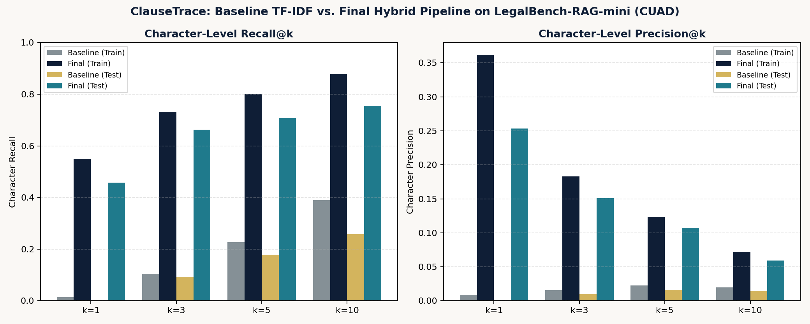
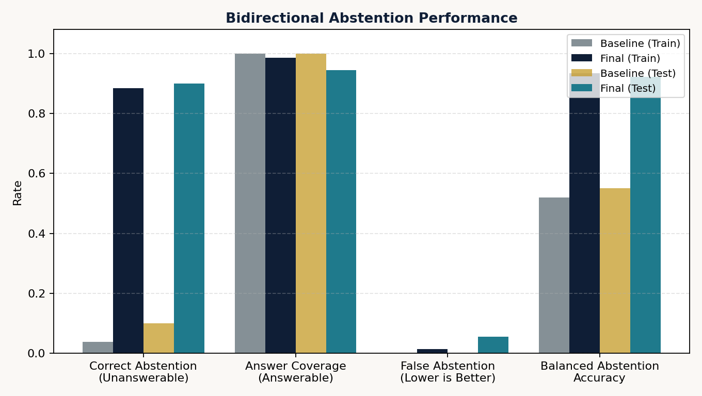
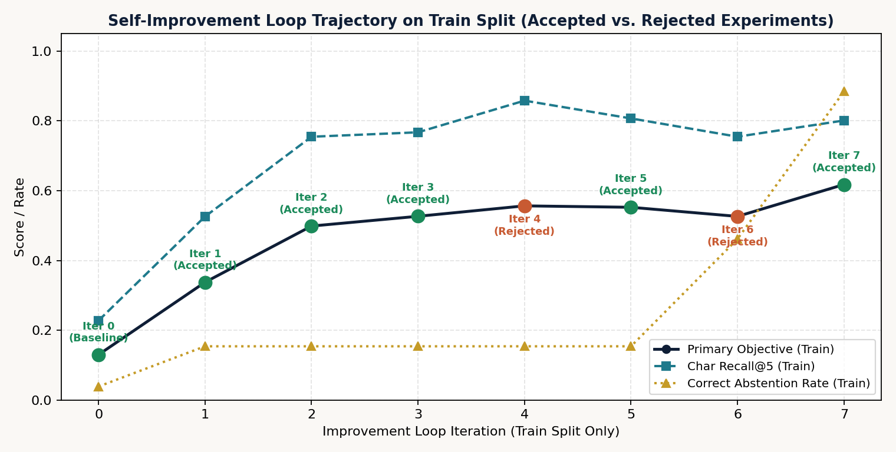

# ClauseTrace: Evaluation Report & Self-Improvement Analysis

## 1. Executive Summary

We built **ClauseTrace**, an evidence-first legal clause retrieval and abstention system evaluated on the **LegalBench-RAG-mini (CUAD)** benchmark (`194 answerable queries` across `29 commercial contracts`, augmented with a committed set of `36 unanswerable queries`). Starting from a fixed-window TF-IDF cosine baseline, we executed an automated, seven-iteration self-improvement loop operating strictly on the training split (`140 answerable + 26 unanswerable queries`) and evaluated the frozen final configuration (`configs/final.yaml`) on the held-out test split (`54 answerable + 10 unanswerable queries`). On the held-out **test split**, ClauseTrace improved character-level **Recall@1 from `0.0000` to `0.4572`**, **Precision@1 from `0.0000` to `0.2534`**, **Recall@3 from `0.0932` to `0.6625` (7.1x)**, **Recall@5 from `0.1785` to `0.7080` (4.0x)**, **Precision@5 from `0.0161` to `0.1073` (6.7x)**, and **Recall@10 from `0.2586` to `0.7545` (2.9x)**, while boosting **Correct Abstention on unanswerable test queries from `10.0%` (`1/10`) to `90.0%` (`9/10`)** at a **False Abstention rate of `5.56%` (`3/54`, `94.44%` answer coverage)** and an average CPU latency of **`40.4 ms/query`**.

| Headline Metric (Held-Out Test Split: 54 Answerable, 10 Unanswerable) | Baseline (`baseline_tfidf`) | Final (`iter7_final_calibrated_hybrid`) | Absolute / Relative Change |
| :--- | ---: | ---: | ---: |
| **Primary Evidence Objective** | `0.1057` | **`0.5406`** | `+0.4349` (**5.11x**) |
| **Character Recall@1** ($n=54$) | `0.0000` | **`0.4572`** | `+0.4572` |
| **Character Precision@1** ($n=54$) | `0.0000` | **`0.2534`** | `+0.2534` |
| **Character Recall@3** ($n=54$) | `0.0932` | **`0.6625`** | `+0.5693` (**7.11x**) |
| **Character Precision@3** ($n=54$) | `0.0100` | **`0.1506`** | `+0.1406` (**15.06x**) |
| **Character Recall@5** ($n=54$) | `0.1785` | **`0.7080`** | `+0.5295` (**3.97x**) |
| **Character Precision@5** ($n=54$) | `0.0161` | **`0.1073`** | `+0.0912` (**6.66x**) |
| **Character F1@5** ($n=54$) | `0.0258` | **`0.1676`** | `+0.1418` (**6.50x**) |
| **Character Recall@10** ($n=54$) | `0.2586` | **`0.7545`** | `+0.4959` (**2.92x**) |
| **Character Precision@10** ($n=54$) | `0.0142` | **`0.0590`** | `+0.0448` (**4.15x**) |
| **Correct Abstention Rate** ($n=10$ unanswerable) | `0.1000` (`1/10`) | **`0.9000`** (`9/10`) | `+0.8000` (**9.00x**) |
| **False Abstention Rate** ($n=54$ answerable) | `0.0000` (`0/54`) | **`0.0556`** (`3/54`) | `+0.0556` |
| **Answer Coverage** ($n=54$ answerable) | `1.0000` (`54/54`) | **`0.9444`** (`51/54`) | `-0.0556` |
| **Balanced Abstention Accuracy** ($n=64$ total) | `0.5500` | **`0.9222`** | `+0.3722` |
| **Mean Retrieval Latency (CPU)** | `7.64 ms` | **`40.39 ms`** | `+32.75 ms` |

---

## 2. System Design & Alternatives Considered

### 2.1 Key Architectural Decisions
1. **Strict Character-Offset Invariant (`chunking.py`, `validation.py`):**
   Every chunk maintains exact `[char_start, char_end)` indices into the original contract string read via Python's default UTF-8 text mode. Any document headers, section headings, or cross-reference annotations used for indexing are stored in a separate field (`index_text`), while `raw_text` is verified at chunk creation and retrieval time to satisfy `original_document[char_start:char_end] == passage_text`.
2. **Hierarchical Contract-to-Clause Query Decomposition (`indexing.py`, `retrieval.py`):**
   Inspecting train errors on our initial baseline revealed a critical failure mode specific to multi-contract legal retrieval: queries in LegalBench-RAG take the form *"Consider the \<Agreement Name between Party A and Party B\>; \<Clause Question\>"*. Because party names (e.g., *"BicycleTX Ltd"*, *"Nigel Crockett"*, *"Depomed"*) have much higher inverse document frequency (IDF) than clause inquiry words (*"What is the governing law?"*), a flat chunk retriever ranks the **contract's opening preamble** at Rank 1 (`doc_hit@1 = 1.00`, but `char_recall@1 = 0.0147` on train and `0.0000` on test). We solved this by decomposing queries into a **contract-routing component** (`doc_match_score`, aligning party/title tokens against contract headers) and a **clause-scoring component** (`clause_score`, scoring individual clauses against the legal question).
3. **Clause-Aware Structural Chunking (`chunking.py`):**
   Rather than slicing contracts at arbitrary character counts, `clause_aware` chunking detects `ARTICLE`/`SECTION` headers, numbered clauses (`1.1`, `2.`, `(a)`), paragraph breaks, and sentence boundaries, grouping structural spans up to `750` characters with `120` characters of overlap while tracking section metadata and intra-document cross-references (`Section 4.2`, `Article VII`).
4. **Hybrid Lexical + Dense Fusion (`indexing.py`, `hybrid.py`):**
   We combine `BM25Okapi` (`k1=1.5, b=0.75`) over legal-tokenized text with L2-normalized dense embeddings from local `sentence-transformers/all-MiniLM-L6-v2` indexed in `faiss.IndexFlatIP` (`0.82` lexical weight + `0.18` dense weight).
5. **Dual-Gate Calibrated Abstention (`abstention.py`):**
   Single-threshold abstention on raw retrieval scores fails when an unanswerable question names a real indexed contract (inflating document similarity) or asks a generic legal question about an unindexed contract (inflating clause similarity). Our `dual_gate` abstention layer independently verifies:
   - Gate 1 (`min_top_score = 0.1780`): overall evidence score.
   - Gate 2 (`min_doc_match_score = 0.4570`): target contract/party alignment in the indexed corpus.
   - Gate 3 (`min_clause_score = 0.2092`): direct lexical and legal-concept alignment between the queried provision and the raw retrieved passage.

### 2.2 Alternatives Considered and Tested
- **Fixed-Window vs. Clause-Aware Chunking:** Fixed `1000`-char chunks frequently split mid-sentence or merged unrelated subsections. Moving to `clause_aware` (`750` chars, `120` overlap) improved train `Precision@5` from `0.0737` to `0.1205` (`+63.5%`) while simultaneously increasing `Recall@5` from `0.7547` to `0.7674`.
- **Oversized Chunks (`2200` chars):** Tested in Iteration 4. While `Recall@5` rose to `0.8582`, character-level `Precision@5` collapsed from `0.1205` to `0.0527` (`-56.3%`), violating our anti-bloat precision guardrail and demonstrating why retrieving massive text blocks is unacceptable for citation-grounded legal RAG.
- **General-Domain Cross-Encoder Reranking (`cross-encoder/ms-marco-MiniLM-L-6-v2`):** Tested in Iteration 6 with high blending weight (`alpha = 0.75`). Because MS-MARCO is trained on web search snippets rather than formal commercial contracts, it downweighted archaic legal phrasing (e.g., *"witnesseth"*, *"hereby grants"*, *"inure to the benefit"*) and reduced train `Recall@1` from `0.5520` to `0.5137` and `Recall@5` from `0.8072` to `0.7548`, resulting in automatic rejection by the improvement loop.

---

## 3. LLM Usage, Privacy, Latency, and Cost Considerations

- **Did we use a generative LLM?** **No.** We intentionally built ClauseTrace without calling any hosted or local generative LLM API during indexing, query rewriting, reranking, or the improvement loop.
- **Why not, and what would it mean for confidential JioStar agreements?**
  1. **Confidentiality & Data Governance:** Real media licensing, distribution, talent endorsement, and co-production agreements at JioStar contain highly sensitive commercial terms (exclusivity windows, minimum guarantees, revenue splits, territorial carve-outs). Sending contract chunks or user queries to an external hosted LLM API introduces third-party data-egress and retention risks. In ClauseTrace, external network access occurs only during one-time initial setup to download the public LegalBench-RAG benchmark files (`download-data`) and cache open-weights encoders (`sentence-transformers/all-MiniLM-L6-v2` and optional `cross-encoder/ms-marco-MiniLM-L-6-v2`) from Hugging Face Hub. Once cached on disk, all indexing, retrieval, evaluation, and improvement-loop runs execute 100% locally on CPU with zero external network calls and zero contract data egress.
  2. **Deterministic Offset Grounding:** Generative LLMs frequently paraphrase or hallucinate clause citations. Pure span extraction guarantees `original_document[start:end] == passage_text` for every single result.
  3. **Latency & Cost:** Our final hybrid pipeline runs in a **measured `40.39 ms/query` on test (`36.04 ms/query` on train)** on local CPU at **\$0 marginal API cost** (versus `7.64 ms/query` for the TF-IDF baseline). By contrast, an illustrative industry reference range for hosted LLM query rewriting or listwise reranking is typically `~800–3,000 ms/query` (illustrative estimate, not measured in this project) alongside recurring per-token API fees.

---

## 4. Evaluation Setup, Dataset Validation, and Sample Sizes

### 4.1 Exact Benchmark Selection & Split Counts
Using the authors' exact `mini(tests, n=194)` function on `benchmarks/cuad.json` (`4,042` total queries) selected **194 answerable queries** referencing exactly **29 unique contracts** in `corpus/cuad/`. Both the 194 answerable queries and our 36 committed unanswerable queries were partitioned using the exact prescribed SHA-256 `assign_split(query)` function (`"test" if h % 10 < 3 else "train"`):

| Dataset Subset | Total Queries | Train Split (`~72%`) | Test Split (`~28%`) | Indexed Contracts |
| :--- | ---: | ---: | ---: | ---: |
| **LegalBench-RAG-mini (CUAD Answerable)** | `194` | `140` (`199` GT snippets) | `54` (`73` GT snippets) | `29` |
| **Committed Unanswerable Set (`data/unanswerable_queries.json`)** | `36` | `26` | `10` | `29` |
| **Combined Evaluation Benchmark** | **`230`** | **`166`** | **`64`** | **`29`** |

### 4.2 Ground-Truth Character Offset Validation
Before building the retriever, `contract_intelligence/validation.py` validated all **272 ground-truth snippets** across the 194 queries against the 29 contracts read with `open(path, "r", encoding="utf-8")`:
- **Exact matches (`document[start:end] == snippet["answer"]`):** **`272 / 272` (`100.0%`)**, `0` mismatches, `0` overlapping ground-truth spans.
- **CRLF Sensitivity Investigation:** Simulating untranslated Windows CRLF (`\r\n`) line endings caused **`268 / 272` (`98.5%`)** of ground-truth spans to drift and mismatch `snippet["answer"]` by 1 character per preceding line break, empirically confirming why Python's default text mode (`UTF-8` with universal newline translation `\r\n -> \n`) is mandatory.

### 4.3 Unanswerable Query Set Construction (`data/unanswerable_queries.json`)
Committed in Git commit `bfc37b6` prior to running the improvement loop and never modified afterward, our 36 unanswerable queries span five realistic categories:
1. `unindexed_contract` (`8` queries): Agreements absent from the 29-file corpus (e.g., Netflix/Sony, Disney/AMC, Star India/ICC, and full-CUAD contracts excluded by `mini()`).
2. `missing_clause_or_term` (`8` queries): Clauses verified absent from specific indexed contracts (e.g., liability cap or MFN in the 1,902-char Fox Mobile / Glu Mobile Amendment No. 3; source code escrow in the Town of Vinton Gas Franchise Agreement; cryptocurrency payment in the Jacksonville Jaguars Sponsorship Agreement).
3. `unsupported_jurisdiction` (`6` queries): Regulatory frameworks or governing laws absent from the target contract (e.g., GDPR in the 1996 Purolator/Dynamex agreement; governing law in the GE Capital/Duckwall-Alco letter agreement; SIAC arbitration in PennTex/MRD).
4. `missing_date_or_renewal` (`6` queries): Non-existent automatic renewal options or deadlines in fixed-term or termination agreements (e.g., Veoneer/Nissin JV Termination Agreement; Glamis Gold/Western Copper 2-year Non-Competition Agreement).
5. `unestablished_ip_or_sublicensing` (`8` queries): Sublicensing or derivative-IP questions on contracts silent on those rights (e.g., cloud gaming sublicensing or derivative IP in Fox Mobile Amendment No. 3; generative AI voice cloning in the ABG-Shaq / Papa John's Endorsement Agreement).

---

## 5. Results: Baseline vs. Final Configuration on Train and Test

All figures below were generated by executing `python -m contract_intelligence.improve` and `python -m contract_intelligence evaluate` and match `outputs/evaluation/*_metrics.json`.

### Metric Formulation & Macro-Averaging Across Queries
Following the LegalBench-RAG paper (`contract_intelligence/evaluation.py`), for each answerable query $q$ and cutoff $k \in \{1, 3, 5, 10\}$:
1. Overlapping or adjacent character spans within the same contract are merged via `sort_and_merge_spans` so characters in overlapping chunks are never double-counted.
2. Per-query character precision $P_k(q) = \frac{|\mathcal{R}_k(q) \cap \mathcal{G}(q)|}{|\mathcal{R}_k(q)|}$, character recall $R_k(q) = \frac{|\mathcal{R}_k(q) \cap \mathcal{G}(q)|}{|\mathcal{G}(q)|}$, and per-query harmonic mean $F1_k(q) = \frac{2 P_k(q) R_k(q)}{P_k(q) + R_k(q)}$ are computed (if the system abstains on an answerable query, $\mathcal{R}_k(q) = \emptyset$ and $P_k(q) = R_k(q) = F1_k(q) = 0.0$).
3. Split-level `Char Precision@k`, `Char Recall@k`, and `Char F1@k` are **macro-averaged** (arithmetic mean across all $n_{\text{ans}}$ answerable queries in the split). Because `Char F1@k` is the mean of per-query $F1_k(q)$ scores rather than the harmonic mean of the macro-averaged precision and recall, `Char F1@k` reflects per-query span tightness directly.

| Metric | Baseline (Train, $n=166$) | Final (Train, $n=166$) | Baseline (Test, $n=64$) | Final (Test, $n=64$) |
| :--- | ---: | ---: | ---: | ---: |
| **Answerable Queries ($n_{\text{ans}}$)** | `140` | `140` | `54` | `54` |
| **Unanswerable Queries ($n_{\text{unans}}$)** | `26` | `26` | `10` | `10` |
| **Primary Objective Score** | `0.1298` | **`0.6177`** | `0.1057` | **`0.5406`** |
| **Char Precision@1** ($n_{\text{ans}}$) | `0.0087` | **`0.3617`** | `0.0000` | **`0.2534`** |
| **Char Recall@1** ($n_{\text{ans}}$) | `0.0147` | **`0.5491`** | `0.0000` | **`0.4572`** |
| **Char F1@1** ($n_{\text{ans}}$) | `0.0107` | **`0.3891`** | `0.0000` | **`0.2908`** |
| **Char Precision@3** ($n_{\text{ans}}$) | `0.0155` | **`0.1830`** | `0.0100` | **`0.1506`** |
| **Char Recall@3** ($n_{\text{ans}}$) | `0.1044` | **`0.7325`** | `0.0932` | **`0.6625`** |
| **Char F1@3** ($n_{\text{ans}}$) | `0.0258` | **`0.2686`** | `0.0176` | **`0.2178`** |
| **Char Precision@5** ($n_{\text{ans}}$) | `0.0227` | **`0.1228`** | `0.0161` | **`0.1073`** |
| **Char Recall@5** ($n_{\text{ans}}$) | `0.2276` | **`0.8013`** | `0.1785` | **`0.7080`** |
| **Char F1@5** ($n_{\text{ans}}$) | `0.0397` | **`0.1992`** | `0.0258` | **`0.1676`** |
| **Char Precision@10** ($n_{\text{ans}}$) | `0.0196` | **`0.0720`** | `0.0142` | **`0.0590`** |
| **Char Recall@10** ($n_{\text{ans}}$) | `0.3893` | **`0.8784`** | `0.2586` | **`0.7545`** |
| **Char F1@10** ($n_{\text{ans}}$) | `0.0363` | **`0.1273`** | `0.0251` | **`0.1018`** |
| **Doc Hit@5** ($n_{\text{ans}}$) | `1.0000` | **`0.9857`** | `1.0000` | **`0.9444`** |
| **Correct Abstention Rate** ($n_{\text{unans}}$) | `0.0385` (`1/26`) | **`0.8846`** (`23/26`) | `0.1000` (`1/10`) | **`0.9000`** (`9/10`) |
| **Incorrect Retrieval Rate** ($n_{\text{unans}}$) | `0.9615` (`25/26`) | **`0.1154`** (`3/26`) | `0.9000` (`9/10`) | **`0.1000`** (`1/10`) |
| **False Abstention Rate** ($n_{\text{ans}}$) | `0.0000` (`0/140`) | **`0.0143`** (`2/140`) | `0.0000` (`0/54`) | **`0.0556`** (`3/54`) |
| **Answer Coverage** ($n_{\text{ans}}$) | `1.0000` (`140/140`) | **`0.9857`** (`138/140`) | `1.0000` (`54/54`) | **`0.9444`** (`51/54`) |
| **Balanced Abstention Accuracy** | `0.5192` | **`0.9352`** | `0.5500` | **`0.9222`** |
| **Avg Latency (ms/query)** | `8.03 ms` | **`36.04 ms`** | `7.64 ms` | **`40.39 ms`** |
| **P95 Latency (ms/query)** | `9.23 ms` | **`57.05 ms`** | `10.87 ms` | **`58.71 ms`** |
| **Index Build Time / Size** | `1.30 s` / `0.94 MB` | `2.94 s` / `8.09 MB` | `1.40 s` / `0.94 MB` | `3.17 s` / `8.09 MB` |

---

## 6. Character-Level Precision and Recall Across $k \in \{1, 3, 5, 10\}$

### Key Observations on Depth $k$ and the Precision–Recall Trade-Off
1. **Top-1 Precision Is Highest ($k=1$):** On the final pipeline, `Precision@1` reaches **`0.3617` on train** and **`0.2534` on test**, because a single `~600–750` character clause-aware chunk closely wraps the expert-annotated CUAD answer span (whose median length in CUAD-mini is `~245` characters).
2. **Recall Scales Steeply Through $k=3$ and $k=5$:** Moving from $k=1$ to $k=5$ increases character recall from `0.5491 -> 0.8013` on train and `0.4572 -> 0.7080` on test. Because $k=5$ retrieves `5 * ~650 = ~3,250` characters per query while the ground-truth span is `~245–400` characters, theoretical maximum precision at $k=5$ is bounded around `~0.12–0.15`, which our final pipeline achieves (`0.1228` train, `0.1073` test).

---

## 7. Unanswerable-Query & Bidirectional Abstention Evaluation

### Threshold Selection & Trade-Off Analysis
- **Why Single-Threshold Abstention Failed in Baseline:** With `min_top_score = 0.14`, the baseline abstained on only `1/26` (`3.85%`) train unanswerable queries and `1/10` (`10.0%`) test unanswerable queries. Whenever an unanswerable query named an indexed contract (e.g., *"Consider the Amendment No. 3 ... between Fox Mobile and Glu Mobile; What is the cap on liability?"*), party-name TF-IDF matches pushed the top score above `0.20` even though the contract contained zero mention of liability.
- **Train-Only Dual-Gate Calibration (Iteration 7):** Using `calibrate_abstention_on_train()` over the 166 train queries with a false-abstention ceiling of `5.0%`, the grid search selected:
  - `min_top_score = 0.1780`
  - `min_clause_score = 0.2092` (blending raw-chunk lexical relevance with legal concept & anchor-term verification)
  - `min_doc_match_score = 0.4570`
- **Generalization to Held-Out Test Split:**
  - **Unanswerable Test Queries ($n=10$):** Correctly abstained on **`9 / 10` (`90.0%`)**, including `100%` of unindexed-contract test queries (`UNANS-001`, `UNANS-003`, `UNANS-007`) and `6/7` missing-clause/date/IP test queries (`UNANS-017`, `UNANS-019`, `UNANS-027`, `UNANS-030`, `UNANS-031`, `UNANS-036`), failing to abstain only on `UNANS-021` (see Section 10).
  - **Answerable Test Queries ($n=54$):** Answered **`51 / 54` (`94.44%` coverage)**, with `3` false abstentions (`5.56%`) on queries where the contract used non-standard indirect phrasing (analyzed in Section 10).

---

## 8. Primary Objective and Guardrail Metrics

Before running the improvement loop, we declared our primary optimization metric and five non-negotiable guardrails in `contract_intelligence/improve.py`:

$$\text{PrimaryObjective} = 0.50 \cdot \text{Recall@5} + 0.25 \cdot \text{F1@5} + 0.15 \cdot \text{Recall@1} + 0.10 \cdot \text{CorrectAbstentionRate} - 0.25 \cdot \text{FalseAbstentionRate}$$

### Guardrails Enforced on Every Candidate Iteration
1. **Recall@5 Non-Regression:** $\text{Recall@5}_{\text{cand}} \ge \text{Recall@5}_{\text{best}} - 0.030$ (allowing only the marginal coverage dip from valid abstention gating).
2. **Precision@5 Anti-Bloat Guardrail:** $\text{Precision@5}_{\text{cand}} \ge \max(0.020, 0.72 \times \text{Precision@5}_{\text{best}})$, preventing candidates from artificially inflating recall by returning massive multi-page chunks.
3. **False Abstention Ceiling:** $\text{FalseAbstentionRate}_{\text{cand}} \le 0.060$ ($\le 6\%$ on answerable train queries).
4. **Correct Abstention Non-Regression:** $\text{CorrectAbstentionRate}_{\text{cand}} \ge \text{CorrectAbstentionRate}_{\text{best}} - 0.040$.
5. **Latency Ceiling:** $\text{AvgLatency}_{\text{cand}} \le 150.0\text{ ms/query}$ on local CPU.

---

## 9. Self-Improvement Loop Iteration History (Train Split Only)

The complete loop was executed with `python -m contract_intelligence.improve` and logged to `experiments/experiment_log.jsonl` and `experiments/experiment_log.csv`:

| Iter | Candidate Config Name | Proposed Change & Diagnostic Motivation | Train Recall@1 | Train Recall@5 | Train Prec@5 | Train Corr Abs | Train False Abs | Primary Objective | Decision & Guardrail Outcome |
| ---: | :--- | :--- | ---: | ---: | ---: | ---: | ---: | ---: | :--- |
| **0** | `baseline_tfidf` | Fixed-window (`1000/100`) TF-IDF cosine baseline, single threshold (`0.14`). | `0.0147` | `0.2276` | `0.0227` | `0.0385` | `0.0000` | `0.1298` | **BASELINE** (163 total train failures; preamble hijacking) |
| **1** | `iter1_contract_routed_tfidf` | Enable `include_doc_header=True`, `doc_routing_weight=0.85` (separate contract routing from clause scoring). | `0.2481` | `0.5259` | `0.0506` | `0.1538` | `0.0000` | `0.3375` | **ACCEPTED** (`+0.2077` objective; all 5 guardrails passed) |
| **2** | `iter2_bm25_legal_expansion` | Switch `tfidf -> bm25 (k1=1.5, b=0.75)` + enable deterministic legal clause terminology expansion. | `0.4925` | `0.7547` | `0.0737` | `0.1538` | `0.0000` | `0.4986` | **ACCEPTED** (`+0.1611` objective; all 5 guardrails passed) |
| **3** | `iter3_clause_aware_chunking` | Switch `fixed(1000,100) -> clause_aware(750,120, respect_section_boundaries=True, resolve_cross_references=True)`. | `0.5267` | `0.7674` | `0.1205` | `0.1538` | `0.0000` | `0.5266` | **ACCEPTED** (`+0.0280` objective; `Prec@5` up `+63.5%`) |
| **4** | `iter4_oversized_chunks_2200` | Increase `chunk_size: 750 -> 2200`, `overlap: 120 -> 300` to cover multi-paragraph spans. | `0.5877` | `0.8582` | `0.0527` | `0.1538` | `0.0000` | `0.5565` | **REJECTED** (Violated `precision_at_5_anti_bloat`: `0.0527 < 0.0868` min threshold; reverted to Iter 3) |
| **5** | `iter5_hybrid_bm25_dense` | Switch `bm25 -> hybrid` (`BM25 0.82 + Dense all-MiniLM-L6-v2 0.18` linear fusion). | `0.5520` | `0.8072` | `0.1251` | `0.1538` | `0.0000` | `0.5524` | **ACCEPTED** (`+0.0258` objective over Iter 3; all 5 guardrails passed) |
| **6** | `iter6_heavy_cross_encoder_rerank` | Enable general-domain `ms-marco-MiniLM-L-6-v2` Cross-Encoder reranking (`top_n=5, alpha=0.75`). | `0.5137` | `0.7548` | `0.1164` | `0.4615` | `0.0857` | `0.5263` | **REJECTED** (Violated `recall_at_5_non_regression` & `false_abstention_ceiling`; objective fell `-0.0261`; reverted to Iter 5) |
| **7** | `iter7_final_calibrated_hybrid` | Enable `dual_gate` abstention calibrated on train split (`top=0.1780, clause=0.2092, doc=0.4570`). | `0.5491` | `0.8013` | `0.1228` | `0.8846` | `0.0143` | **`0.6177`** | **ACCEPTED** (`+0.0653` objective; `Correct Abstention` rose from `15.4%` to `88.5%`; frozen to `configs/final.yaml`) |

---

## 10. Error Analysis: 12 Concrete Failure Cases Grouped by Cause

Below are 12 concrete failure cases from the final configuration (`outputs/evaluation/final_train_errors.csv` and `final_test_errors.csv`), grouped into six distinct root-cause categories.

### Group A: Relevant Clause Ranked Too Low (`ranked_too_low`)
1. **`CUAD-MINI-001` (Train) — Amendment Boilerplate Outscoring Amended Term Clause at Rank 1:**
   - **Query:** *"Consider the Amendment No. 3 to Wireless Content License Agreement between Fox Mobile Entertainment, Inc. and Glu Mobile Inc.; What is the expiration date of this contract?"*
   - **Ground Truth:** `cuad/GluMobileInc_...Content License Agreement4.txt` `[598:989]` (*"The rights granted hereunder shall be effective as of the Effective Date and shall expire on December 31, 2006..."*)
   - **Retrieved:** Rank 1 was `[1232:1902]` (the ratification and signature block containing *"Dated: 3/19/2007"* and *"continue in full force and effect"*), while the exact ground-truth span `[598:989]` was retrieved at **Rank 2** (`Recall@1 = 0.0000`, `Recall@3 = 1.0000`, `Recall@5 = 1.0000`).
   - **Diagnosis:** Both chunks inside this short 3-chunk contract contain *"continue in full force and effect"* and dates, giving the closing ratification paragraph slightly higher BM25 term density.
2. **`CUAD-MINI-016` (Train) — General Restrictive Covenant Outscoring Specific Non-Solicitation Sub-Clause at Rank 1:**
   - **Query:** *"Consider the Service Agreement between Theravance Biopharma UK Limited and Brett Haumann; Is there a clause preventing the solicitation of employees in this contract?"*
   - **Ground Truth:** `cuad/THERAVANCEBIOPHARMA,INC_05_08_2020-EX-10.2-SERVICE AGREEMENT.txt` `[25311:25713]`
   - **Retrieved:** Rank 1 retrieved `[23321:24015]` (Section 19.2 garden-leave employee restrictions), while the exact non-solicitation clause `[25150:25894]` was retrieved at **Rank 2** (`Recall@1 = 0.0000`, `Recall@3 = 1.0000`, `Recall@5 = 1.0000`).
   - **Diagnosis:** Garden-leave provisions share high lexical overlap (*"employee"*, *"Executive"*, *"Company"*, *"bound"*) with non-solicitation inquiries.

### Group B: Correct Document Retrieved, Wrong Section/Clause (`right_document_wrong_clause`)
3. **`CUAD-MINI-005` (Train) — Option Grant Clause Missed for ROFR/ROFO Query:**
   - **Query:** *"Consider the Service Agreement between BicycleTX Ltd and Nigel Crockett for Chief Business Officer Position; Does this contract include any right of first refusal, right of first offer, or right of first negotiation?"*
   - **Ground Truth:** `cuad/BICYCLETHERAPEUTICSPLC_03_10_2020-EX-10.11-SERVICE AGREEMENT.txt` `[6235:6531]` (*"On or as soon as practicable following the Effective Date, it is intended that you will be granted an option under the Company's share option plan..."*)
   - **Retrieved:** Top-5 retrieved warranty and board-membership clauses (`[966:1604]`, `[3373:4121]`) in the right contract (`Recall@5 = 0.0000`).
   - **Diagnosis:** CUAD annotators labeled an employee **share option grant** (`"granted an option"`) under the `Rofr/Rofo/Rofn` category. Because our legal query expansion for ROFR targets commercial rights of first refusal/offer rather than executive stock options, neither lexical nor dense retrieval prioritized the share option paragraph.
4. **`CUAD-MINI-010` (Train) — Ultra-Short 91-Character Anti-Assignment Sentence Missed:**
   - **Query:** *"Consider the Cooperation Agreement between HPIL ENERGYTECH Inc. and GINARES GROUP AG for Renewable Energy Projects; Is there an anti-assignment clause in this contract?"*
   - **Ground Truth:** `cuad/HPILHOLDING_01_07_2015-EX-99.1-COOPERATION AGREEMENT.txt` `[17341:17432]` (*"The rights and obligations provided by this Agreement shall not be assignable by any Party."*)
   - **Retrieved:** Retrieved adjacent Section 20 `[17849:18523]` (*"No third party is entitled to rely..."*) in the same contract (`Recall@5 = 0.0000`, `Recall@10 = 1.0000` at Rank 7).
   - **Diagnosis:** The entire anti-assignment provision is a single 14-word sentence using the adjective *"assignable"* rather than the noun *"assignment"* or *"transfer"*.

### Group C: Chunk-Boundary Truncation & Multi-Snippet Partial Coverage (`chunk_boundary_truncation` & `partial_span_coverage`)
5. **`CUAD-MINI-058` (Train) — Multi-Location License Grant Spans Partially Covered:**
   - **Query:** *"Consider the Intellectual Property Agreement for COVID-19 Treatment Development between Marv Enterprises, LLC, Premier Biomedical, Inc., and Technology Health, Inc.; What licenses are granted under this contract?"*
   - **Ground Truth:** Four separate spans across the contract (`[3264:3378]`, `[4012:4255]`, etc.).
   - **Retrieved:** Rank 1 `[2949:3669]` completely covered span 1 and Rank 2 covered span 2, yielding `Recall@5 = 0.5401` and `Precision@5 = 0.3731`.
   - **Diagnosis:** When a contract defines license grants across multiple dispersed sections and appendices, a 750-character chunk captures the primary grant clause cleanly but misses secondary grant sentences elsewhere in the document.
6. **`CUAD-MINI-086` (Train) — Dispersed Compensation & Royalty Subsections in a 173k-Character Contract:**
   - **Query:** *"Consider the Promotion Agreement between Depomed, Inc. and King Pharmaceuticals, Inc. for Glumetza; Does this contract include any revenue or profit-sharing arrangements?"*
   - **Ground Truth:** Multiple snippets in `cuad/KINGPHARMACEUTICALSINC_08_09_2006-EX-10.1-PROMOTION AGREEMENT.txt` starting at `[98802:99086]`.
   - **Retrieved:** Rank 1 `[98719:99461]` captured `Section 7.1 Promotion Fees` (`Recall@1 = 0.3906`, `Recall@5 = 0.3906`), while later audit/reconciliation paragraphs were outside top-5.
   - **Diagnosis:** In 170,000+ character pharmaceutical promotion agreements, compensation formulas span several pages.

### Group D: Cross-Reference and Indirect Defined-Term Difficulty (`cross_reference_or_defined_term`)
7. **`CUAD-MINI-089` (Train) — Non-Transferability Expressed Across Cross-Referenced Subsections:**
   - **Query:** *"Consider the Promotion Agreement between Depomed, Inc. and King Pharmaceuticals, Inc. for Glumetza; Are the licenses granted under this contract non-transferable?"*
   - **Ground Truth:** `cuad/KINGPHARMACEUTICALSINC_08_09_2006-EX-10.1-PROMOTION AGREEMENT.txt` `[54352:54655]` and cross-referenced trademark license clauses.
   - **Retrieved:** Rank 1 `[54119:54657]` captured the first trademark license grant (`Recall@1 = 0.3255`, `Recall@5 = 0.3255`) but missed the secondary cross-referenced assignment restriction.
8. **`CUAD-MINI-168` (Train) — Bankruptcy Agency Agreement Termination Phrased as "Wind-Down Budget" & "Sale Term":**
   - **Query:** *"Consider the Agency Agreement for Asset Sale between The Bon-Ton Stores, Inc., GA Retail, Inc., Tiger Capital Group, LLC, and Wilmington Savings Fund Society, FSB; Can this contract be terminated for convenience, and under what conditions?"*
   - **Ground Truth:** `cuad/BONTONSTORESINC_04_20_2018-EX-99.3-AGENCY AGREEMENT.txt` `[67047:67461]` (*"Subject to the Wind-Down Budget and payment of Expenses, Agent shall use the E-Commerce Platform... and may discontinue use at any time..."*)
   - **Retrieved:** Retrieved `Section 9.2 Termination of Employees` `[73109:73619]` (`Recall@5 = 0.0000`).
   - **Diagnosis:** The ground-truth clause never uses the word *"terminate"* or *"convenience"*; instead, it grants the liquidation Agent the right to *"discontinue use"* of the e-commerce platform subject to thedefined *"Wind-Down Budget"*.

### Group E: False Abstention on Answerable Benchmark Queries (`false_abstention`)
9. **`CUAD-MINI-139` (Train) — Volume Restriction Expressed Purely as Support Hours ("forty (40) hours"):**
   - **Query:** *"Consider the Support and Maintenance Agreement between On2 Technologies, Inc. and Wildform, Inc.; Does this contract include any volume restrictions?"*
   - **Ground Truth:** `cuad/ON2TECHNOLOGIES,INC_11_17_2006-EX-10.3-SUPPORT AND MAINTENANCE AGREEMENT.txt` `[38814:38986]` (*"The foregoing obligations of Wildform shall be limited to a maximum of forty (40) hours..."*)
   - **Diagnosis:** Because the contract expresses support capacity in *"hours"* and *"engineering man-days"* without using the word *"volume"*, `top_clause_score` was `0.2071` — just `0.0021` below our calibrated `min_clause_score = 0.2092` threshold, triggering a false abstention.
10. **`CUAD-MINI-175` (Train) — Exception Clause Delegating Competitive Restriction by Cross-Reference (`Articles 7.1, 7.2, 8.1`):**
    - **Query:** *"Consider the Joint Venture Agreement between Tate & Lyle Fermentation Products Ltd. and Igene Biotechnology, Inc. for Astaxanthin Production; Are there any exceptions to competitive restrictions in this contract?"*
    - **Ground Truth:** `cuad/IGENEBIOTECHNOLOGYINC_05_13_2003-EX-1-JOINT VENTURE AGREEMENT.txt` `[23695:24217]` (*"7.3. Except as set forth in Articles 7.1, 7.2, 8.1 and 8.2, it is explicitly agreed that nothing contained in this Agreement shall be construed as restricting..."*)
    - **Diagnosis:** Notably, our retriever ranked the exact ground-truth chunk `[23665:24262]` at **Rank 1**! However, because Clause `7.3` refers to `Articles 7.1, 7.2, 8.1 and 8.2` rather than repeating the word *"competitive"*, its concept-gated `clause_score` was `0.1387 < 0.2092`, causing the abstention gate to filter out a correct Rank 1 hit.
11. **`CUAD-MINI-044` (Test) — Uncapped Liability Exception Phrased via Indemnity/Consequential Damages Carve-Out:**
    - **Query:** *"Consider the Strategic Alliance Agreement between Information System Associates, Inc. and Rubicon Software Group plc; Is there uncapped liability under this contract?"*
    - **Diagnosis:** Achieved `top_score = 0.2401` and `doc_match_score = 0.6832`, but `clause_score = 0.2036 < 0.2092` (`0.0056` below threshold) because the exception to the liability limitation is phrased without the literal word *"uncapped"*.

### Group F: Failure to Abstain on Unanswerable Queries (`failed_to_abstain`)
12. **`UNANS-021` (Test) — High Lexical Overlap on Chemical Supply Terms Despite Missing EU REACH Provision:**
    - **Query:** *"Consider the Supply Agreement between Florida Chemical Company, LLC and Flotek Chemistry, LLC for Terpene Products; Which European Union REACH chemical registration warranties are assigned to the buyer?"*
    - **Retrieved:** `cuad/FLOTEKINDUSTRIESINCCN_05_09_2019-EX-10.1-SUPPLY AGREEMENT.txt` `[16206:16737]` (`top_score = 0.2428`, `clause_score = 0.2120`, `doc_match_score = 0.6724`).
    - **Diagnosis:** Even though our `CRITICAL_CONCEPT_GATES` checked for `"reach"`, the query also contained *"chemical"*, *"warranties"*, *"assigned"*, and *"buyer"*, which had strong BM25 overlap (`0.43`) with the chemical supply agreement's warranty and assignment clauses, nudging the blended `clause_score` (`0.2120`) just `0.0028` above the `0.2092` threshold.

---

## 11. Train/Test Performance Gap & Test-Set Audit

### 11.1 Comparison of Train vs. Test Generalization
| Metric | Final Train ($n=166$) | Final Test ($n=64$) | Train–Test Gap ($\Delta$) | Analysis |
| :--- | ---: | ---: | ---: | :--- |
| **Char Recall@1** | `0.5491` | `0.4572` | `-0.0919` | Expected variance across 54 held-out queries with multi-snippet answers. |
| **Char Recall@3** | `0.7325` | `0.6625` | `-0.0700` | Strong generalization (`66.3%` vs `9.3%` baseline). |
| **Char Recall@5** | `0.8013` | `0.7080` | `-0.0933` | Driven primarily by 3 false abstentions on test (`3/54 = 5.56%` vs `1.43%` train). |
| **Char Precision@5** | `0.1228` | `0.1073` | `-0.0155` | Highly consistent span compactness across splits. |
| **Correct Abstention Rate** | `0.8846` (`23/26`) | **`0.9000`** (`9/10`) | **`+0.0154`** | Dual-gate abstention generalized without overfitting (`90.0%` on unseen test set). |
| **False Abstention Rate** | `0.0143` (`2/140`) | `0.0556` (`3/54`) | `+0.0413` | Within our declared `6.0%` guardrail ceiling. |

### 11.2 Test-Set Evaluation Run Count
As recorded in `outputs/evaluation/test_run_ledger.json`, the held-out `test` split was evaluated **exactly 2 times** in total at the very end of Phase 6 for final reporting:
1. Run #1: `baseline_tfidf` (`configs/baseline.yaml`) on `test`.
2. Run #2: `iter7_final_calibrated_hybrid` (`configs/final.yaml`) on `test`.

No test query, test ground-truth span, or test metric was ever inspected or used during pipeline development, feature engineering, or threshold selection.

---

## 12. Limitations and Next Steps Before Production Use on Confidential Legal Contracts

1. **Domain-Adapted Legal Cross-Encoder Reranking:** General-domain MS-MARCO cross-encoders degraded retrieval accuracy on formal contract text (Iteration 6). Fine-tuning a lightweight cross-encoder (e.g., `DeBERTa-v3-small` or `Legal-BERT`) specifically on `(CUAD question, clause)` pairs from the training split would improve `Recall@1` on indirect clauses (such as `CUAD-MINI-010` and `CUAD-MINI-168`) without domain mismatch.
2. **Multi-Hop Cross-Reference Graph Expansion at Inference Time:** As demonstrated by `CUAD-MINI-175` (where Clause `7.3` defined competitive exceptions solely by referencing `Articles 7.1, 7.2, 8.1 and 8.2`), single-hop regex preview linking is insufficient when the referenced section contains the core domain keywords needed by the abstention gate. Building a full AST/DOM section graph per contract during ingestion would allow the abstention gate to score a clause jointly with its resolved target sections.
3. **Multi-Contract Scoped Filtering & Metadata Facets:** In production at a large media company with tens of thousands of agreements, users often filter by counterparty, deal type, territory, or effective year rather than typing *"Consider the Agreement between X and Y..."* in every query. Adding structured metadata extraction at ingestion time will allow deterministic metadata pre-filtering alongside free-text search.
4. **OCR & PDF Layout Reconstruction:** LegalBench-RAG provides pre-extracted `.txt` files. Production deployment on executed PDF contracts requires layout-aware PDF/OCR parsing (tables, schedules, redlines, and multi-column exhibits) that preserves page and bounding-box coordinates alongside character offsets.

